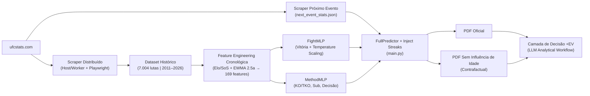

# 🥋 UFC Fight Outcome & Method Predictor

> Pipeline *end-to-end* de Ciência de Dados, Deep Learning Calibrado e Apoio à Decisão Quantitativa (+EV) para previsão de combates do UFC.


---

## 📌 Visão Geral

Este projeto implementa um sistema preditivo completo para eventos do UFC, desenhado com foco em **calibração probabilística**, **rigor temporal (zero *data leakage*)** e **tomada de decisão orientada a Valor Esperado Positivo (+EV)**.

Em vez de tratar a previsão de lutas como um problema ingênuo de classificação binária, a arquitetura separa o problema em:
1. **Coleta Histórica Distribuída & Point-in-Time** diretamente do `ufcstats.com`.
2. **Engenharia de Atributos Cronológica** (Ratings Elo dinâmicos, *Strength of Schedule* e decaimento exponencial temporal via EWMA).
3. **Modelagem Hierárquica Calibrada** em PyTorch: probabilidade de vitória (`FightMLP`) combinada pela Lei da Probabilidade Total à distribuição condicional de método de vitória (`MethodMLP`).
4. **Análise Contrafactual & Decisão Assistida por LLM**: geração automática de relatórios comparativos (cenário real vs. cenário com idade neutralizada) para auditoria técnica e filtragem matemática de odds via *prompt* estruturado.

---

## 🏗️ Arquitetura do Pipeline



---

## 🛡️ Rigor Metodológico e Prevenção de *Data Leakage*

Um dos principais desafios em modelagem esportiva é evitar o vazamento de informação futura (*look-ahead bias*). O projeto aplica cinco salvaguardas estritas:

1. **Snapshots *Point-in-Time* no Scraping**: durante a construção do histórico (`calc_stats(profile, before=event["date"])`), todas as métricas acumuladas de um atleta são recalculadas considerando **apenas lutas estritamente anteriores** à data do combate avaliado.
2. **Filtro de Estreantes (`total_fights == 0`)**: atletas sem histórico prévio no UFC são removidos antes do treinamento e bloqueados em tempo de inferência (`FightPredictor.predict`), evitando predições sem lastro estatístico.
3. **Split Estritamente Temporal (Out-of-Time)**:
   - **Treino**: `2015-01-03` a `2022-12-17`
   - **Validação**: `2023-01-14` a `2024-12-14`
   - **Teste (Holdout final)**: `2025-01-11` a `2026-07-18`
   - Asserções explícitas garantem ausência de sobreposição de datas entre os conjuntos.
4. **Simetrização (*Mirror Augmentation*) Isolada por Split**: cada luta $(A, B, y)$ é espelhada como $(B, A, 1 - y)$ **dentro** de seu respectivo split para garantir simetria posicional sem que uma luta e seu espelho cruzem entre treino, validação e teste.
5. **Imputação e Escalonamento Sem Vazamento**: medianas por coluna (`col_medians.npy`) e `StandardScaler` (`scaler.pkl`) são ajustados **exclusivamente no conjunto de treino**.

---

## ⚙️ Engenharia de Features (169 Dimensões)

O vetor de entrada (`build_row_features`) possui **169 features** construídas de forma idêntica em treino e inferência:

| Grupo | Qtd. | Descrição |
| :--- | :---: | :--- |
| **Deltas Numéricos (`A - B`)** | 34 | Diferença direta das estatísticas base (`NUMERIC_BASE`: antropometria, cartel, golpes/min, quedas/15min, absorção, tempo médio de luta e métricas EWMA). |
| **Valores Absolutos (`A` e `B`)** | 68 | As 34 métricas base preservadas individualmente para cada lutador (permite à rede capturar efeitos não-lineares de escala). |
| **Features Derivadas (`_derived`)** | 33 | 11 razões para A, 11 para B e 11 deltas: `win_rate`, `finish_rate`, `ko_rate`, `sub_rate`, `dec_rate`, `loss_rate`, `exp_score` ($\log(1 + N)$), `grapple_score`, `been_finished_rate`, `ko_vulnerability`, `sub_vulnerability`. |
| **Sequências (*Streaks*)** | 6 | `win_streak`, `loss_streak` de cada atleta e seus respectivos deltas (`A - B`). |
| **Elo Dinâmico & *Strength of Schedule*** | 19 | `elo`, `strike_elo`, `grapple_elo`, `opp_elo_avg`, `beaten_elo_avg`, `elo_momentum` (A, B, deltas) + probabilidade esperada Elo centrada (`elo_expected_a - 0.5`). |
| **Matchup de Bases (*Stance*)** | 9 | *One-hot encoding* de `Orthodox`, `Southpaw` e `Switch` para ambos + indicadores de confronto assimétrico (`sa != sb`) e presença de canhotos. |

### Destaques de Engenharia Temporal
- **Sistema Elo Especializado**: calculado cronologicamente em `compute_streaks` com $K=36$ para lutadores com menos de 4 lutas e $K=24$ após estabilização, ponderado por contundência do desfecho (`1.35x` no R1, `1.20x` no R2, `1.15x` no R3+ para KO/Sub; `0.75x` para decisão dividida) e acompanhado de ratings específicos de *striking* e *grappling*.
- **Decaimento Temporal Exponencial (EWMA — meia-vida de 2.5 anos)**: em `_update_and_get_ewma`, as estatísticas individuais de cada luta passada são reconstruídas pelo delta entre snapshots acumulados consecutivos e ponderadas por $w_i = \exp(-\lambda \cdot \Delta t_{\text{anos}})$, alimentando `last_fight_1..5` (`ewma_win_rate`, `form_win_trend`, `form_sig_trend`, `form_td_trend`, `ewma_sig_diff`).

---

## 🧠 Arquitetura dos Modelos e Calibração

Em problemas de decisão sob incerteza e precificação de risco, **calibração probabilística** (Log-Loss e Brier Score) é mais crítica do que acurácia isolada.

### 1. Modelo Primário de Vitória (`FightMLP` — `model/train.py`)
- **Arquitetura**: MLP tabular `169 → 512 → 256 → 128 → 64 → 2` com `BatchNorm1d`, ativação `GELU` e `Dropout` progressivo (`0.40`, `0.35`, `0.25`, `0.15`).
- **Otimização**: `AdamW` (`lr=2e-4`, `weight_decay=2e-3`), `OneCycleLR` (`max_lr=5e-4`), *gradient clipping* (`1.0`) e *early stopping* (`patience=40`).
- **Pós-processamento**: **Temperature Scaling** (`TemperatureScaler`) ajustado via `LBFGS` exclusivamente no conjunto de validação para calibrar a confiança dos logits antes do `softmax`.

### 2. Modelo Secundário de Método (`MethodMLP` — `model/train_method.py`)
- Treinado sobre o subconjunto masculino (`ufc_dataset_male_only.csv`, **6.076 lutas**) posicionando sempre o vencedor real no slot A (`build_Xy_method`).
- Classifica o método condicional $P(\text{Método} \mid \text{A vence B})$ em 3 classes (`KO/TKO`, `Submissão`, `Decisão`) utilizando `CrossEntropyLoss` ponderada pelo inverso da frequência das classes (`class_weights`).

### 3. Composição Probabilística (`FullPredictor` — `model/predict_method.py`)
Combina os dois modelos pela **Lei da Probabilidade Total**:
$$P(A \text{ vence por } M) = P(A \text{ vence}) \times P(M \mid A \text{ vence } B)$$
Produzindo 6 desfechos mutuamente exclusivos que somam 100%, além de estimar linhas de duração (*Under/Over 2.5 e 1.5 rounds*) multiplicando a probabilidade combinada de via rápida pelos fatores empíricos históricos de conversão por categoria de peso (`fluxo/time_discount_factors.md`).

---

## 📊 Resultados (Conjunto de Teste *Out-of-Time*: `2025-01-11` → `2026-07-18`)

Métricas registradas nos artefatos atuais (`model/artifacts/meta.json` e `model/artifacts_method/meta.json`):

| Modelo | Dataset | Features | Acurácia (Teste) | ROC-AUC | Log-Loss | Brier Score |
| :--- | :--- | :---: | :---: | :---: | :---: | :---: |
| **`FightMLP` (Vitória)** | `ufc_dataset.csv` (7.004 lutas) | 169 | **66.21%** | **0.7034** | **0.6436** | **0.2258** |
| **`MethodMLP` (Método)** | `ufc_dataset_male_only.csv` (6.076 lutas) | 169 | **49.03%** | — | **1.0332** | — |

---

## 🔍 Análise Contrafactual e Camada de Decisão com GenAI

Ao executar `main.py`, o sistema gera **dois relatórios PDF** para o mesmo evento em `output/`:
1. **`<Evento> - Oficial.pdf`**: inferência com os atributos reais dos atletas.
2. **`<Evento> - Sem Influencia Idade.pdf`**: experimento contrafactual onde a idade de ambos os lutadores é igualada à média do confronto `(age_a + age_b) / 2`. Isso permite auditar se o favoritismo do modelo vem de **superioridade técnica/estatística** ou apenas de **viés etário**.

Esses relatórios alimentam o protocolo determinístico descrito em [`output/fluxo.md`](output/fluxo.md), projetado para ser operado por um **LLM como consultor quantitativo**:
- **Estratégia A (Zebras / Value Bets)**: probabilidades oficiais entre `35.0%` e `49.9%` quando a odd de mercado for $\ge 4.00$.
- **Estratégia B (Favoritos Técnicos)**: exige aprovação simultânea no cenário Oficial ($\ge 10\%$ de confiança) e no cenário Sem Idade ($\ge 5\%$ de confiança), bifurcando entre *Moneyline* ($\text{odd} \ge 1.40$) ou *Prop Bets* de método com *breakevens* calibrados empiricamente (Decisão $\ge 1.63$, KO/TKO $\ge 1.96$ com $\text{prob} \ge 40\%$, Submissão $\ge 3.02$ com $\text{prob} \ge 40\%$).

---

## 🌐 Engenharia de Dados Distribuída

Para acelerar a coleta histórica no `ufcstats.com` sem violar o modelo de *greenlets* do `sync_playwright`:
- `scripts/global_distribuido/ufc_scraper_global.py` isola o Playwright em uma thread dedicada consumindo uma `queue.Queue` com `concurrent.futures.Future`.
- `host.py` expõe uma fila HTTP (`GET /next_event`, `POST /submit_event` na porta `5000`) permitindo que múltiplos `worker.py` em máquinas distintas processem eventos em paralelo e consolidem o resultado em `ufc_dataset.csv`.

---

## 📁 Estrutura do Repositório

```text
UFC-PREDICTOR/
├── main.py                          # Orquestrador: injeta Elo/streaks e gera os 2 PDFs
├── pyproject.toml                   # Dependências e configuração do ambiente Python
├── model/
│   ├── train.py                     # Treino FightMLP + Elo/EWMA + Temperature Scaling
│   ├── train_method.py              # Treino MethodMLP (3 classes, masculino)
│   ├── predict.py                   # FightPredictor (inferência + trava de estreantes)
│   ├── predict_method.py            # MethodPredictor e FullPredictor (prob. total)
│   ├── artifacts/                   # Pesos, scaler, medianas, temperatura e meta.json
│   └── artifacts_method/            # Artefatos do modelo de método
├── scripts/
│   ├── ufc_scraper_next_event.py    # Coleta do próximo card → next_event_stats.json
│   ├── ufc_scraper_event.py         # Coleta de evento específico por URL
│   ├── ufc_scraper_fighter.py       # CLI para perfil individual de lutador
│   ├── calculate_time_discount.py   # Cálculo empírico dos fatores Under 1.5 / 2.5
│   ├── global_local/                # Scraper completo local (com suporte a resume)
│   └── global_distribuido/          # Scraper distribuído Host/Worker + split de gênero
├── fluxo/                           # Documentação do pipeline analítico e fatores
├── output/                          # PDFs gerados, logs de treino e fluxo.md (+EV)
└── events/                          # Histórico de eventos e relatórios já processados
```

---

## 🚀 Como Executar

### 1. Instalação do Ambiente
```bash
uv sync
# ou: pip install -r <(uv export)
playwright install chromium
```

### 2. Coletar o Próximo Evento do UFC
```bash
cd scripts
python ufc_scraper_next_event.py
```
Gera `scripts/next_event_stats.json` com as estatísticas atualizadas e os termos EWMA (`last_fight_1..5`) de cada lutador do card.

### 3. Gerar Relatórios Preditivos (PDFs)
Na raiz do projeto:
```bash
python main.py
```
Informe o nome do evento quando solicitado. Os arquivos `<Evento> - Oficial.pdf` e `<Evento> - Sem Influencia Idade.pdf` serão salvos em `output/`.

### 4. Retreinar os Modelos (Opcional)
```bash
cd model
python train.py         # Treina o FightMLP e salva artefatos em model/artifacts/
python train_method.py  # Treina o MethodMLP e salva artefatos em model/artifacts_method/
```

---

## 🔭 Limitações Conhecidas e Roadmap Técnico

- **Sincronização de Elo na Inferência**: `main.py` calcula `last_fight_1..5` preservando o scraping ao vivo via `setdefault`, mas os ratings Elo e *streaks* dependem de `scripts/global_distribuido/ufc_dataset.csv` estar atualizado até o evento imediatamente anterior.
- **Calibração Ponderada no `MethodMLP`**: `train_method.py` aplica `class_weights` na loss de treino, mas chama `calibrate_temperature` sem repassar os pesos para a calibração LBFGS (embora o suporte já exista em `train.py`).
- **Higiene de Artefatos**: `model/artifacts/isotonic_calibrator.pkl` é um artefato legado não utilizado pela versão atual baseada em Temperature Scaling.
- **Próximos Passos**: inclusão explícita de variáveis contextuais da luta (3 vs. 5 rounds, *short-notice*, mudança de categoria de peso) e integração automatizada de APIs de odds para cálculo de *Kelly Criterion* fracionado em tempo real.
